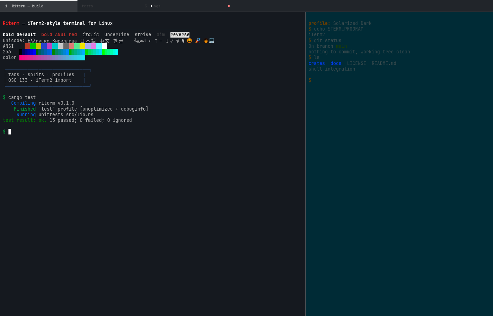

# Riterm

**Riterm** is an iTerm2-style terminal emulator for Linux, written in Rust.

It brings the parts of iTerm2 that matter day-to-day to Wayland and X11:
GPU-accelerated rendering, tabs and recursive splits, named profiles, iTerm2's
built-in color presets and profile import, font fallback, scrollback search,
vi-style copy mode, and iTerm2-compatible OSC 133 shell integration. It is not
a macOS app port; it is a native Linux terminal that speaks iTerm2's protocols
and configuration formats.



> **Status: early, usable, and expanding.** The terminal, tabs, splits,
> profiles, built-in themes, font fallback, cursor blinking, imports, search,
> copy mode, and shell integration work. tmux control mode, triggers, inline
> images, and scripting are on the roadmap. See
> [docs/FEATURE_MATRIX.md](docs/FEATURE_MATRIX.md) and
> [docs/ROADMAP.md](docs/ROADMAP.md).

## Highlights

- **Exact iTerm2 colors.** Riterm ships all 11 built-in iTerm2 color presets
  from iTerm2's own `ColorPresets.plist`, including `(Dark)` and `(Light)`
  variants. The default profile matches iTerm2's Default Bookmark / Smoooooth
  colors byte for byte.
- **iTerm2 typography.** Primary font, fallback chain, separate non-ASCII font,
  font size, line height, bold/italic font toggles, OpenType feature options,
  and iTerm2 font-name parsing during import.
- **Real fallback rendering.** ASCII runs are shaped for exact grid alignment;
  non-ASCII clusters are shaped individually at their cell positions, and RTL
  scripts are shaped as runs so Arabic and Hebrew letters can join.
- **iTerm2 color semantics.** Bold color, bright-bold ANSI colors, cursor text
  color, selected text color, link color, and iTerm2's minimum-contrast
  algorithm.
- **GPU rendering** with `wgpu` and `glyphon`: true color, bold, italic,
  underline, double underline, strikethrough, wide characters, block/beam/
  underline/hollow cursors, blinking cursor, selection, search highlights, and
  a live tab bar.
- **Scrollback search** over the whole buffer, case-insensitive, with match
  count, next/previous navigation, and highlighted hits.
- **Copy mode** with vi-style motions (`h j k l`, `w b e`, `0 $`, `g G`),
  keyboard selection, and yank to the clipboard.
- **Terminal core** from `alacritty_terminal`: full VT/ANSI parsing, scrollback,
  alternate screen, bracketed paste, mouse reporting, OSC clipboard and title
  handling.
- **Tabs and recursive splits** with keyboard focus movement, pane zoom, and
  scrollback paging.
- **Profiles** in TOML, with named profiles that inherit from `[profile]`.
- **iTerm2 compatibility**
  - Built-in preset selection (`--theme`, `--list-themes`, `theme = "..."`).
  - Import `.itermcolors` color presets (`--import-theme`).
  - Import profiles from `com.googlecode.iterm2.plist` (`--import-iterm2`).
  - OSC 133 `A`/`B`/`C`/`D` shell integration marks, command status, and
    per-tab running/failure indicators.
  - Sets `TERM_PROGRAM=iTerm2`, `LC_TERMINAL=iTerm2`, `ITERM_SESSION_ID`, and
    `RITERM=1` for shells and tools that check for iTerm2.
- **Shell integration installer** for bash, zsh, and fish
  (`--install-shell-integration`), including OSC 7 working-directory reporting.
- **Clipboard and mouse**: drag selection, copy/paste, optional copy-on-select,
  and mouse wheel scrolling.

## Build

Requirements:

- Rust 1.85 or newer (edition 2024)
- Wayland or X11 development libraries (winit)
- Vulkan or another `wgpu` backend (software `llvmpipe` also works)
- `fontconfig`
- `pkg-config`

```sh
cargo build --release
./target/release/riterm
```

For development:

```sh
cargo run
cargo test

# Deterministic offscreen frame (no window or Wayland session required)
cargo run -- --render-check /tmp/riterm.png
```

## Usage

```text
riterm [OPTIONS]

Options:
      --config <FILE>                 Path to config.toml
      --theme <NAME_OR_FILE>          Built-in iTerm2 preset or .itermcolors file
      --list-themes                   List built-in iTerm2 color presets and exit
      --import-iterm2 <PLIST>         Import profiles from iTerm2 and exit
      --import-theme <FILE>           Import an .itermcolors preset and exit
      --install-shell-integration [<SHELL>]
                                      Install bash, zsh, fish, or all
      --render-check <FILE>           Render a deterministic frame to a PNG and exit
  -e, --execute <COMMAND>...          Run a command instead of the login shell
  -h, --help                          Print help
  -V, --version                       Print version
```

Examples:

```sh
riterm -e "htop"
riterm --list-themes
riterm --theme "Solarized Dark"
riterm --import-theme ~/Downloads/Solarized.itermcolors
riterm --import-iterm2 ~/Library/Preferences/com.googlecode.iterm2.plist
riterm --install-shell-integration all
riterm --render-check /tmp/riterm.png
```

The default config lives at `~/.config/riterm/config.toml` (the lowercase path
is intentional and stable) and is created on first launch.

## Configuration

```toml
[general]
default_profile = "Default"
scrollback = 1000
tab_bar_height = 30.0
padding = 6.0
copy_on_select = false
theme = "Smoooooth"          # any preset from --list-themes, or a file path
theme_variant = "dark"       # dark | light | auto
# shell = "/bin/zsh"
# shell_args = ["-l"]
# working_directory = "~"

[profile]
font_family = "JetBrainsMono Nerd Font"
font_fallbacks = [
  "Noto Sans Mono CJK JP",
  "Liberation Mono",
]
non_ascii_font_family = "Noto Sans Mono CJK JP"
use_non_ascii_font = true
font_size = 13.0
line_height = 1.25
use_bold_font = true
use_italic_font = true
use_bright_bold = true
# font_features = ["liga", "calt", "ss01"]
# foreground = "#dcdcdc"
# background = "#15191f"
# bold = "#ffffff"
# cursor = "#ffffff"
# cursor_text = "#000000"
# selection = "#b3d7ff"
# selection_text = "#000000"
# link = "#328eee"
cursor_shape = "block"       # block | beam | underline | hollow
cursor_blink = false
minimum_contrast = 0.0

[profiles.Work]
font_size = 14.0
background = "#0f141a"

[keybindings]
# "ctrl+shift+enter" = "new_tab"
```

`[profiles.NAME]` overrides only the fields it sets. `[profile]` is the base
for every profile. `theme_variant = "auto"` follows `RITERM_THEME_VARIANT`,
then `COLORFGBG`, then dark.

### Built-in iTerm2 presets

`Regular`, `High Contrast`, `Solarized`, `Light Background`, `Dark Background`,
`Solarized Light`, `Solarized Dark`, `Pastel (Dark Background)`, `Tango Light`,
`Tango Dark`, and `Smoooooth`.

## Keybindings

| Chord | Action |
|---|---|
| `Ctrl+Shift+T` | New tab |
| `Ctrl+Shift+W` | Close pane (or tab) |
| `Ctrl+Tab` / `Ctrl+Shift+Tab` | Next / previous tab |
| `Ctrl+Shift+1..9` | Select tab |
| `Ctrl+Shift+D` | Split side by side |
| `Ctrl+Shift+E` | Split stacked |
| `Ctrl+Shift+Arrow` | Move focus between panes |
| `Ctrl+Shift+C` / `Ctrl+Shift+V` | Copy selection / paste |
| `Ctrl+=` / `Ctrl+-` / `Ctrl+0` | Zoom in / out / reset |
| `Shift+PageUp` / `Shift+PageDown` | Scroll page up / down |
| `Ctrl+Shift+Home` / `Ctrl+Shift+End` | Scroll to top / bottom |
| `Ctrl+Shift+K` | Clear scrollback |
| `Ctrl+F` | Search scrollback |
| `F3` / `Shift+F3` | Next / previous search match |
| `Ctrl+Shift+Space` | Toggle copy mode |
| `Esc` | Close search or copy mode |

Override or add bindings in `config.toml`:

```toml
[keybindings]
"ctrl+shift+enter" = "new_tab"
"ctrl+alt+left" = "focus_left"
"ctrl+shift+9" = "select_tab_9"
```

Action names are listed in `crates/riterm/src/input.rs` (`Action::from_name`).

In copy mode: `h j k l` move, `w b e` word motions, `0 $` line start/end,
`g G` scrollback top/bottom, `v` or `Space` toggle selection, `y` or `Enter`
yank and exit, `q` or `Esc` exit. `Ctrl+U/D/F/B` scroll by pages.

## Shell integration

`--install-shell-integration` copies the scripts to
`~/.config/riterm/shell-integration/` and adds a source line to the shell's rc
file. The scripts are plain bash/zsh/fish and only activate when `RITERM` is
set.

Manual installation:

```sh
# bash
. ~/.config/riterm/shell-integration/riterm.bash

# zsh
. ~/.config/riterm/shell-integration/riterm.zsh

# fish
source ~/.config/riterm/shell-integration/riterm.fish
```

The integration emits:

```text
OSC 133;A              prompt start
OSC 133;B              prompt end / user input starts
OSC 133;C              command started
OSC 133;D;<status>     command finished
OSC 7;file://host/path current working directory
```

## Architecture

See [docs/ARCHITECTURE.md](docs/ARCHITECTURE.md) for the crate layout, event
flow, color pipeline, and rendering pipeline.

## iTerm2 parity

Riterm targets maximal Linux-compatible parity, not a literal AppKit port.
Colors, built-in presets, default profile values, font parsing, and several
rendering rules are taken from iTerm2's GPLv3 source. macOS-only features
(AppleScript, Touch Bar, Keychain, Sparkle, Services, AppKit panes) are
explicit non-goals. See [docs/FEATURE_MATRIX.md](docs/FEATURE_MATRIX.md) for a
feature-by-feature comparison.

The iTerm2 source revision studied, copied plists, and regeneration
instructions are documented in
[third_party/iterm2/README.md](third_party/iterm2/README.md).

## License

Riterm is licensed under **GPL-3.0-or-later**. This is required because parts
of its design, colors, and protocol behavior were studied and adapted from
iTerm2's GPLv3-licensed source. See [LICENSE](LICENSE).

iTerm2 is a trademark of its respective owners. Riterm is an independent
project and is not affiliated with or endorsed by iTerm2.
